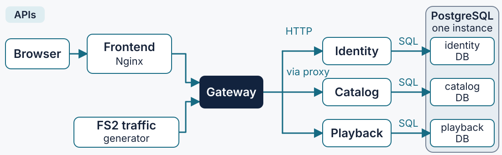
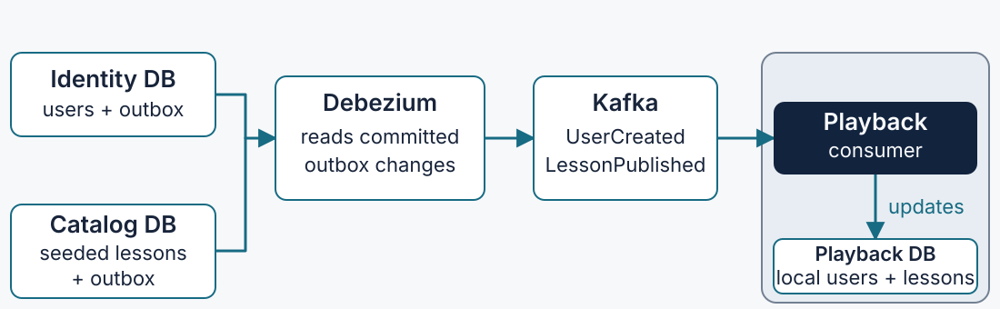
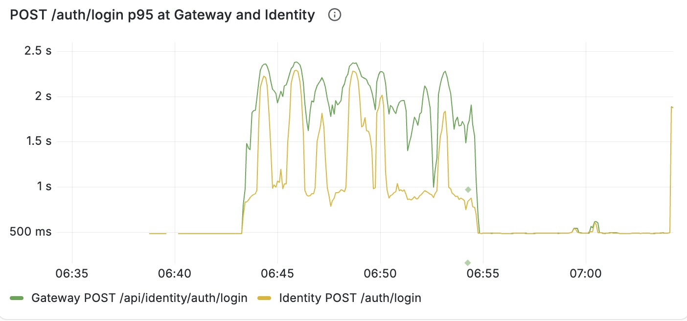
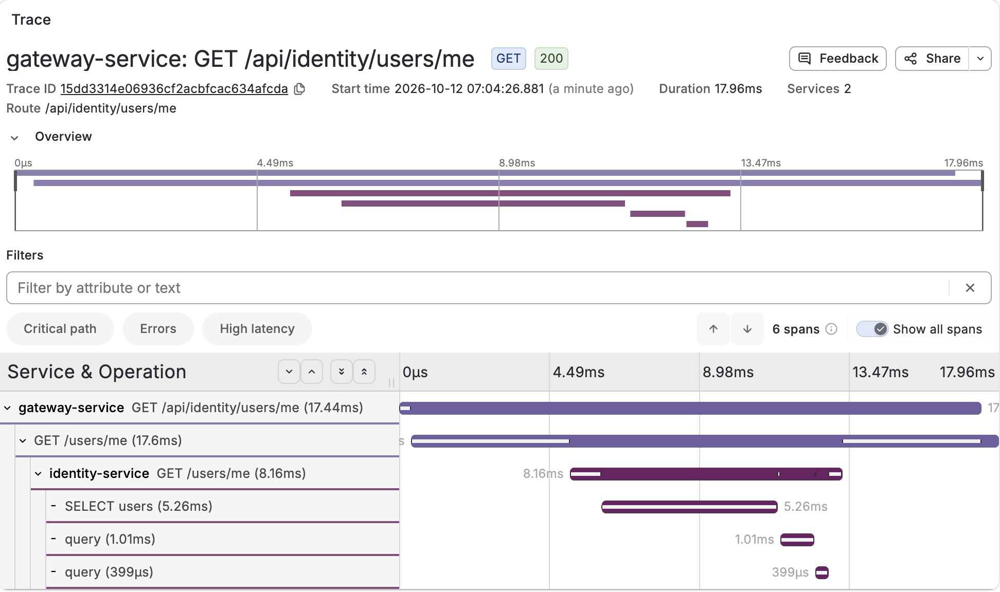

<!-- _class: lead -->
<!-- _paginate: false -->

# A distributed system on fire

## Diagnosing failures with otel4s

**An interactive Typelevel lab**

<!-- Presenter: Welcome. Move straight to setup so downloads run during the introduction. Antonio introduces the application and stack before Maksim explains telemetry and the investigation approach. -->

---

# Start the lab now

[tinyurl.com/tl-otel4s-lab](https://tinyurl.com/tl-otel4s-lab)

Clone the repository, then run from its root:

```bash
./scripts/lab.sh start
```

[Setup instructions and prerequisites](https://github.com/antoniojimeneznieto/typelevel-video-streaming#requirements)

**Leave this running while we introduce the system.**

<!-- Presenter: Start downloads immediately. The README currently contains the participant setup instructions: Java 17+, sbt, and Docker with Compose v2 running. Help participants clone the repository and run the command from its root. The first start pulls published images and initializes the application, so it can take several minutes. Continue the introduction while setup runs. -->

---

# Your mission

> Investigate an unfamiliar service through the evidence it emits.

- Find the affected users and requests.
- Follow the request path and locate the failure.
- Record a hypothesis and the observations supporting it.
- Verify recovery under the workload that exposed the problem.

Inspect source when the evidence narrows the search.

<!-- Presenter: Participants can work in pairs. They do not need prior knowledge of the code or APIs. Start with runtime evidence and discover the request path through traces. Source becomes useful for explaining an operation or adding missing observations. -->

---

# The Typelevel stack

| Component | Role in the application |
| --- | --- |
| Cats Effect | Effects, concurrency, and resource lifetimes |
| FS2 | Streams and generated workshop traffic |
| http4s + Smithy4s | HTTP transport and shared API contracts |
| Skunk | PostgreSQL access |
| Calico + Scala.js | Browser application |
| otel4s | OpenTelemetry instrumentation |

**Smithy contracts** define routes, payloads, and authentication requirements.
Their route templates also label HTTP telemetry.

<!-- Presenter: Hand over to Antonio for the backend tour. Introduce the stack by role before showing the application and its architecture. The workshop exercises HTTP and database boundaries, runtime behavior, and application observations. Identity, Catalog, and Playback expose generated Smithy4s service interfaces implemented in Scala; http4s serves them. The shared contract also supplies stable route templates such as /courses/{courseId}/lessons/{lessonId}/playback, instead of a metric label for every ID. Gateway reuses those contracts for its public prefixes. Sources: build.sbt; shared/api-contracts/src/main/smithy; backend/modules/runtime/src/main/scala/org/typelevel/video/streaming/backend/runtime/http/SmithyRouteClassifier.scala; GatewayRouteClassifier.scala. -->

---

# The application

A video learning platform: browse courses, sign in, play videos, and save progress.

| Service | Responsibility |
| --- | --- |
| Gateway | Routes application API requests |
| Identity | Accounts, login, and access tokens |
| Catalog | Course discovery and learning paths |
| Playback | Video access, favorites, and progress |

When setup finishes, open **http://localhost:8000**.

<!-- Presenter: Continue the 5–7 minute backend tour. Briefly show browsing, login, and playback in the running application if available. In Codespaces use the forwarded frontend port instead of localhost. The following slides explain the normal architecture and API surface; keep incident mechanisms and fixes for the investigation rounds. Sources: shared/api-contracts/src/main/smithy/{catalog,identity,playback}-api.smithy. -->

---

# Backend architecture



One PostgreSQL instance hosts **three service-owned databases**.

Services export telemetry to the **OpenTelemetry collector → Grafana stack**.

<!-- Presenter: Follow a browser API request through the frontend's Nginx proxy, Gateway, and the selected backend. The FS2 generator calls Gateway directly. Each backend uses its own database and pool; they share one PostgreSQL server in the lab. The Catalog HTTP path includes the lab's network proxy; explain its place without demonstrating any fault. This view covers API requests and SQL. The next slide covers asynchronous data, and the Playback slide covers video bytes. Telemetry flows separately through the collector in the LGTM container to Tempo, Loki, and Prometheus, viewed in Grafana. Sources: compose.yaml; frontend/nginx.conf; GatewayRoutes.scala. -->

---

# How data reaches Playback



Registration writes the user and its outbox event in **one transaction**.

Playback maintains local users and lessons **asynchronously**.

<!-- Presenter: An outbox is a database table holding events alongside business data. Identity inserts a user and UserCreated event atomically, then returns the registration response. Debezium reads committed database changes and publishes them to Kafka; Playback consumes them and updates its own database. Catalog's LessonPublished events are seeded during lab setup: the current Catalog API has no publishing operation. Playback can therefore answer using local user and lesson data instead of calling Identity or Catalog on each request. These copies become available after consumption; registration does not wait for Playback. HTTP trace context is propagated across service calls, but do not promise one end-to-end trace through Debezium: asynchronous correlation depends on the configured instrumentation. Sources: IdentityRepository.create; PlaybackEventWorker; PlaybackProjectionRepository; infrastructure/debezium/*-outbox.json; infrastructure/postgres/init/01-schema.sql. -->

---

# Gateway · the application API entry point

| Incoming prefix | Destination |
| --- | --- |
| `/api/identity/*` | Identity |
| `/api/catalog/*` | Catalog, through the network proxy |
| `/api/playback/*` | Playback |

```text
GET /api/catalog/courses?q=fs2
                 ↓
Catalog: GET /courses?q=fs2
```

Gateway forwards the bearer token. **The destination service authenticates it.**

<!-- Presenter: Gateway removes the service prefix and preserves the remaining path and query. It wraps inbound and outbound HTTP with telemetry, so one API call has a Gateway server span and an outgoing client span before the downstream server span. The default local browser origin is port 8000 through Nginx; Gateway itself is exposed on host port 8085. Prefixes shown here apply to all service-local paths in the following tables. Source: GatewayRoutes.scala; GatewayClient.scala; Identity and Playback Main.scala and BearerAuthenticationMiddleware. -->

---

# Identity · accounts and access tokens

Gateway prefix: `/api/identity`

| Service API | Purpose | Authentication |
| --- | --- | --- |
| `POST /users` | Register an account | Public |
| `POST /auth/login` | Obtain an access token | Public |
| `GET /users/me` | Read the current user | Bearer JWT |

Login returns `accessToken`, `tokenType`, and `expiresIn`.

Send the token as **`Authorization: Bearer <token>`** on protected requests.

<!-- Presenter: Registration accepts email, password, and displayName; it returns the new user with HTTP 201. Login accepts email and password. Identity signs the JWT, and Identity/Playback validate protected requests with the public key in their authentication middleware. Playback does not call Identity to validate each token. Identity stores account data in its own database and produces UserCreated through the outbox shown earlier. Keep incident-specific behavior for the investigation rounds. Source: shared/api-contracts/src/main/smithy/identity-api.smithy; IdentityServiceImpl.scala; Main.scala. -->

---

# Catalog · discover the content

Gateway prefix: `/api/catalog` · **Public read APIs**

| Service API | Returns |
| --- | --- |
| `GET /courses` | Course metadata, instructors, levels, and technologies |
| `GET /learning-paths` | Curated paths containing course IDs |

```http
GET /api/catalog/courses?q=fs2&level=intermediate&limit=10
```

Both collections support **search, filters, and `limit` / `offset` pagination**.

<!-- Presenter: The frontend fetches these collections from Catalog. Courses include descriptions, duration, and lesson count; the video objects live in storage. Course filters also include kind, topic, and technology. Learning paths support level and tone. Both endpoints default to limit=20 and offset=0. The app reads seeded catalog data; there is no course-write or lesson-publish HTTP API in this version. Source: catalog-api.smithy and catalog-domain.smithy. -->

---

<!-- _class: small -->

# Playback · watching and personal learning data

Gateway prefix: `/api/playback` · **All APIs require a bearer JWT**

| Service API | Purpose |
| --- | --- |
| `GET /courses/{courseId}/lessons/{lessonId}/playback` | Return a signed video URL and expiry |
| `PUT /courses/{courseId}/lessons/{lessonId}/progress` | Save `positionSeconds` |
| `GET /progress` | List the current user's progress |
| `GET /favorites` | List the current user's favorites |
| `PUT /favorites/{courseId}` | Add a favorite |
| `DELETE /favorites/{courseId}` | Remove a favorite |

**Video bytes:** Browser → frontend/Nginx → SeaweedFS (S3-compatible storage).

<!-- Presenter: Playback uses its local projections to find the user and lesson. For a playback URL it checks the S3 object with HEAD, then returns JSON containing an expiring signed URL and expiresIn. The browser follows this URL through the frontend's media proxy to SeaweedFS for the MP4, including Range requests; the bytes do not pass through Gateway or Playback. Favorites and progress belong to the authenticated user and are stored in Playback's database. GET /progress can filter by courseId and completed; progress and favorites lists are paginated. Sources: playback-api.smithy; PlaybackServiceImpl.scala; S3VideoStorage.scala; frontend/nginx.conf. -->

---

# Three kinds of evidence

| Signal | Question it helps answer |
| --- | --- |
| **Metrics** | What changed, when, and how broadly? |
| **Traces** | Which operations did a request reach, and where did time go? |
| **Logs** | What did a component observe or decide? |

Use the same service, time window, and request context to connect them.

<!-- Presenter: Introduce the following examples as navigation and signal reading, not an incident diagnosis. Runtime metrics are also metrics. A useful investigation may need several signals, but every incident does not require a logging step. -->

---

# Metrics



Summarize many requests over time.

Compare **rate, errors, and duration** with a healthy window.

Check the route, service, and time range before interpreting a change.

<!-- Presenter: Screenshot from docs/slides/metrics.jpg. Point out the time axis, units, and Gateway and Identity p95 series for login requests. Explain p95 briefly: a duration percentile summarizes a population, not one request. Do not diagnose the caller/server difference yet. The screenshot illustrates reading a dashboard, not the current lab state. -->

---

# Traces



Show one request's lifecycle.

This successful user lookup crosses **Gateway, Identity, and SQL**.

Spans identify operations, parent relationships, and elapsed time.

<!-- Presenter: Successful trace from docs/slides/traces.jpg. Point to the trace ID, GET /api/identity/users/me, status 200, child Identity span, and SQL children. Nested durations overlap and cannot simply be added. This request is an example, not proof that all requests are healthy. -->

---

# Logs

Capture events and decisions inside an operation.

A useful application log explains **what happened**, with context for that event.

In Grafana, follow a trace's log link to Loki and filter to the same request.

**A trace ID connects the event to its request lifecycle.**

<!-- Presenter: Show the configured trace-to-log link during the live tour if logs are available. Compare timestamp, service, trace ID, and span ID. A message without request context can be difficult to place in a distributed flow. Log contents depend on application instrumentation. Avoid revealing Playback diagnostic fields here. Source: infrastructure/observability/grafana/provisioning/datasources.yaml. -->

---

# Propagation and correlation

```text
Gateway server span
  └─ Catalog client span
       └─ Catalog server span
            └─ SQL span
```

**Propagation** carries trace context across the HTTP call.

Gateway → Catalog HTTP header:

```http
traceparent: 00-4bf92f3577b34da6a3ce929d0e0e4736-00f067aa0ba902b7-01
```

`version-trace ID-parent span ID-flags` · `01` means sampled.

An **exemplar** links a metric observation to a recorded trace.
The trace ID connects that request to its logs.

<!-- Presenter: The example uses the W3C traceparent format. The parent span ID is the Gateway's outgoing Catalog client span; Catalog extracts it to create its server span in the same trace. The 01 flags value marks the context as sampled. Follow one exemplar in Grafana, then show a trace-to-log link. The outgoing instrumentation injects context and incoming instrumentation extracts it. Parent and child spans form one trace. An exemplar is a sampled observation, not necessarily the request at p95. The lab's datasource configuration supplies the navigation links. Trace/log correlation requires logging within the active context. Reference: https://www.w3.org/TR/trace-context/ . -->

---

# otel4s and the Typelevel ecosystem

| Boundary or runtime | Instrumentation |
| --- | --- |
| HTTP | http4s middleware, sttp backends |
| Database | Skunk tracing, doobie integration |
| gRPC | fs2-grpc client and server tracing |
| Messaging | fs2-kafka-otel4s producer and consumer tracing |
| Cats Effect runtime | otel4s runtime metrics |

Add spans, metrics, and contextual logs for application questions.

<!-- Presenter: This lab uses HTTP and Skunk boundary instrumentation and Cats Effect runtime metrics. Integrations reduce the work needed to establish request context and boundary observations. Configure propagation, exporters, and dashboard links, then add domain instrumentation where a question remains unanswered. Integration APIs and platform support vary. References: https://typelevel.org/otel4s/ecosystem.html ; https://typelevel.org/otel4s/how-to-metrics/register-cats-effect-runtime-metrics.html . Skunk use is evidenced by this repository's runtime and repository modules. -->

---

# Our investigation loop

1. **Observe:** compare the baseline with the incident window.
2. **Hypothesize:** write a cause and its supporting evidence.
3. **Distinguish:** collect an observation that tests the explanation.
4. **Correct:** apply the change the evidence supports.
5. **Verify:** check fresh requests under the same workload.

Use runtime metrics, logs, or source when a request trace leaves a question open.

<!-- Presenter: Ask for a claim and an observation, then ask what would distinguish it from another explanation. A deployment becoming ready is not recovery proof. Keep the triggering traffic and verify the affected routes after the change. -->

---

# CLI and incident phases

The stack startup is already running: `./scripts/lab.sh start`.

| Command | What it does |
| --- | --- |
| `incident start ID` | Prepares the round and starts healthy baseline traffic |
| `incident activate ID` | Applies the incident workload or platform fault |
| `incident rebuild` | Deploys source edits while the incident workload continues |
| `incident status` | Reports the saved incident phase |

Prefix each command with `./scripts/lab.sh`.
Open the dashboard URL printed by the baseline command.

<!-- Presenter: Explain the distinction between stack start and incident start. Use the ID shown on the incident slide. Wait for baseline readiness, then observe the healthy window before activation. Allow 2–5 minutes for setup and baseline orientation, and 2–5 minutes to see degradation after activation. Rebuild applies to source-editing rounds, not the platform rollback round. Status reports phase, not workload validity or recovery. -->

---

# Workshop agenda

| Part | Activity |
| --- | --- |
| Introduction | Application and stack, then telemetry, investigation loop, and tools |
| Incident 1 | Catalog slowdown |
| Incident 2 | Identity slowdown |
| Incident 3 | Playback authentication failures |
| Incident 4 | Catalog gradually slows |
| Closing | Lessons, application to your services, and questions |

Each round starts with healthy traffic, then symptoms, hints, and a takeaway.

<!-- Presenter: The session targets two hours. Pace the introduction while initial downloads run, and preserve time for baseline observation, source rebuilds, and sustained recovery. Incident IDs 1–4 follow presentation order. Use a rehearsal to calibrate timing instead of committing participants to exact minute allocations. -->

---

# Incident 1 · Healthy Catalog traffic

Run the baseline:

```bash
./scripts/lab.sh incident start 1
```

Users browse courses through Gateway and Catalog. Traffic is steady and
course pages load quickly.

Open the dashboard URL printed by the command:
**Gateway–Catalog: Request Path**.

Watch the healthy latency and request rate while the baseline settles.

<!-- Presenter: Allow 2–5 minutes for setup and baseline observation. Start waits for a healthy 60-second generator window, fresh metrics, and a trace. Use this time to explain course browsing and help participants open the printed Grafana URL. Record the baseline time. -->

---

# Incident 1 · Slow course browsing

Activate the incident:

```bash
./scripts/lab.sh incident activate 1
```

> Users report that course pages load slowly after a routine platform change.

Find where the requests spend the extra time.

<!-- Presenter: Record activation time. Allow 2–5 minutes to observe the changed window and gather hypotheses. Keep traffic running. Reveal each following hint separately as groups need it. -->

---

# Incident 1 · Hint 1: request latency

Compare Gateway and Catalog latency before and after activation.

**Which latency series changed?**

<!-- Presenter: Use aligned windows on Gateway–Catalog: Request Path. Explain p95 only if needed: the estimated duration below which 95% of observations fall in the selected window. Ask participants to name the affected boundary before advancing. -->

---

# Incident 1 · Hint 2: traffic and failures

Compare the offered request rate and HTTP outcomes with the baseline.

**Did more traffic or more failures accompany the slowdown?**

<!-- Presenter: Check offered, Gateway inbound, Gateway Catalog attempt, and Catalog server rates. Use Workshop Traffic or traffic status to rule out dropped arrivals. Keep this as a distinct check before opening a trace. -->

---

# Incident 1 · Hint 3: one slow request

Open a latency exemplar from the incident window in Tempo.

Follow the request from Gateway to Catalog and SQL.

**Which span contains the added time?**

<!-- Presenter: An exemplar links an individual measurement to a trace, which may differ from the p95 request. Choose a fresh trace from the fault window. Give navigation help without identifying the cause. -->

---

# Incident 1 · Hint 4: client and server time

Compare Gateway's Catalog client span with Catalog's server span.

**Does Catalog spend as long processing the request as Gateway spends
waiting for it?**

<!-- Presenter: Ask participants to explain the gap using the span timeline. The expected evidence is a long client call with short Catalog server and SQL work. Recorded fallback: docs/scenario1-gateway-catalog-boundary.png. -->

---

# Incident 1 · Hint 5: platform changes

List the recorded changes, then inspect a candidate:

```bash
./scripts/lab.sh platform changes
./scripts/lab.sh platform inspect CHANGE_ID
```

**Which change fits both the time window and the boundary evidence?**

<!-- Presenter: Onboard participants to the platform commands here. Let them find the change ID and read its details. Require a trace-based explanation for the selected change before showing rollback. -->

---

# Incident 1 · Hint 6: recovery

Roll back the change supported by your evidence:

```bash
./scripts/lab.sh platform rollback CHANGE_ID
```

Keep traffic running. Compare a fresh trace and latency with the baseline.

**Did the extra client wait disappear?**

<!-- Presenter: Fresh traces can show recovery before the rolling latency graph clears. Keep the offered load unchanged and allow export and refresh delay. Ask groups to explain their recovery evidence. -->

---

# Incident 1 · Takeaway

**Boundary telemetry was enough to locate this latency problem.**

- Metrics showed when request latency changed and how broadly it changed.
- An exemplar connected the graph to an individual request trace.
- Comparing client and server spans located the delay between services.

The same workload confirmed recovery after the platform rollback.

<!-- Presenter: Ask a group to summarize the investigation in order: latency change, load comparison, exemplar, client/server gap, matching platform change, recovery. Mention that boundary instrumentation is the starting point and later incidents add observations where it leaves questions open. -->

---

# Incident 2 · Healthy Identity traffic

Run the baseline:

```bash
./scripts/lab.sh incident start 2
```

Users occasionally log in and regularly check their accounts with
`GET /users/me`. Both operations respond quickly.

Open the printed dashboard URL: **Identity: Login Latency**.

Observe both routes while the baseline settles.

<!-- Presenter: Allow 2–5 minutes for preparation and healthy observation. Baseline is 10 requests/s with 5% login in this checkout. Check valid recent generator windows. The simulated 250 ms check runs on compute workers; password verification already uses IO.blocking. The exercise defect already exists; the next phase changes the workload. -->

---

# Incident 2 · Slow account operations

Activate the incident:

```bash
./scripts/lab.sh incident activate 2
```

> More users are logging in. Logins and lightweight account requests
> both become slow.

Explain why lightweight account requests also slow down.

<!-- Presenter: Activation switches to 70% login at the same total rate, with a brief generator transition. Record the time and allow 2–5 minutes to observe the degradation and gather hypotheses. Reveal hints one at a time. -->

---

# Incident 2 · Hint 1: affected routes

Compare login and `GET /users/me` latency in the same time window.

**Does the slowdown affect only requests that verify a password?**

<!-- Presenter: Use the lightweight route as a control. Confirm offered and completed load using the generator before attributing the change to the application. -->

---

# Incident 2 · Hint 2: request traces

Open a fresh login trace and a fresh current-user trace.

Compare their SQL spans and the time spent outside SQL.

**Which work appears only in the login request?**

<!-- Presenter: Compare `identity.login.legacy_check`, password permit-wait, and verification spans. Use the dashboard trace tables. Short SQL spans help exclude slow queries but cannot explain all time outside SQL. Avoid showing LegacyLoginCheck.scala yet. -->

---

# Incident 2 · Hint 3: authentication work

Compare synchronous check duration with password verification and permit wait.

**Do those signals explain the delay in the lightweight route?**

<!-- Presenter: Keep password work, semaphore contention, and runtime pressure distinct. The lightweight route does not verify a password, so participants need runtime evidence for the effect that spreads to it. -->

---

# Incident 2 · Hint 4: runtime pressure

Use the **Identity Cats Effect scheduler signals** panel, then follow the
**Cats Effect Runtime Metrics** link for a detailed view. Select Identity and
its current instance.

Compare scheduler drift and starvation events with `GET /users/me` latency.

**Can compute workers keep up with unrelated requests?**

<!-- Presenter: otel4s provides Cats Effect runtime instrumentation, and this lab provisions its dashboard. Compare runtime signals with route latency in the same interval. If telemetry becomes unresponsive, use generator output and container health. Missing traces are not evidence of recovery. -->

---

# Incident 2 · Hint 5: executor and repair

Inspect the synchronous authentication check in `LegacyLoginCheck.scala`.

**Which Cats Effect executor runs the synchronous operation?**

After your correction, deploy it:

```bash
./scripts/lab.sh incident rebuild
```

Keep the login-heavy workload and check fresh current-user latency.

<!-- Presenter: Expected repair: IO.blocking instead of IO.delay, preserving the four permits around the simulated 250 ms check. Require a fresh valid sustained window and responsive lightweight requests after warmup. -->

---

# Incident 2 · Takeaway

**A simulated synchronous SDK call occupied compute workers and delayed unrelated requests.**

- Request traces identified the synchronous authentication check.
- A lightweight route provided a control for the slowdown.
- Cats Effect scheduling metrics exposed delayed scheduling.

The repair restored lightweight requests under the same login-heavy workload.

**Moving the call to `IO.blocking` restored scheduling and `GET /users/me` responsiveness, while the SDK still waited about 250 ms.**

<!-- Presenter: Compare fresh route latency and Cats Effect scheduler signals under the same offered mix. The SDK check keeps its own wait; the repair creates scheduling room for unrelated requests. Keep the permit boundary in place, require valid load, and exclude startup/rebuild intervals. -->

---

# Incident 3 · Healthy Playback traffic

Run the baseline:

```bash
./scripts/lab.sh incident start 3
```

Users log in and open their favorites in Playback. Traffic is steady and
Playback requests succeed.

Open the printed dashboard URL: **Playback: Favorites Authentication**.

Observe the response rates and a successful request trace.

<!-- Presenter: Allow 2–5 minutes for setup and baseline observation. Setup authenticates ten synthetic accounts, and baseline measured traffic uses the original group. The printed dashboard has outcome rates and separate successful/rejected trace tables. -->

---

# Incident 3 · Some users receive 401

Activate the incident:

```bash
./scripts/lab.sh incident activate 3
```

A new authentication token model adds a namespace to the subject.

> Some users can log in but consistently receive `401` from Playback.
> Most users remain unaffected.

Find the incompatible step while preserving authentication checks.

<!-- Presenter: The token-model rollout is known briefing context. Activation introduces users with that model into measured Playback traffic; it does not deploy a new decoder. Keep the same total rate. Allow 2–5 minutes to observe the stable minority failure. Reveal the following hints separately. -->

---

# Incident 3 · Hint 1: failure rate

Compare Playback's `200` and `401` rates with the baseline.

**Is the failing share stable or growing?**

<!-- Presenter: Expect a stable minority near 20% in valid recent workload windows. Distinguish a consistent user-group problem from random or accumulating failures. -->

---

# Incident 3 · Hint 2: Gateway and Playback

Open a fresh rejected Playback trace and a successful control.

**Does Gateway reach Playback in both requests?**

<!-- Presenter: Use the two outcome-specific trace tables in the dashboard. Select requests from the same deployment and fault window. Login succeeds for both groups during workload preparation. -->

---

# Incident 3 · Hint 3: repository work

Follow the rejected request inside Playback.

**Does it reach repository spans or SQL?**

<!-- Presenter: Compare the endpoint's successful and rejected paths. Let participants identify where the rejected path ends before naming the decoder implementation. -->

---

# Incident 3 · Hint 4: subject decoding

The `auth.subject.decode` span surrounds conversion of a verified token
subject into a user UUID.

Both successful and rejected requests have this span.

**What does the existing span leave unexplained?**

<!-- Presenter: Explain the observation boundary: JWT validation has already succeeded, and the decoder returns an optional user UUID. PlaybackAuthTelemetry wraps this supplied effect without changing validation behavior. The span locates the stage but does not report input shape or decoding outcome. -->

---

# Incident 3 · Hint 5: diagnostic attributes

Open `PlaybackAuthTelemetry.decodeSubject`.

Enrich the span with context that helps explain the outcome.

**Which bounded values would distinguish successful and rejected requests?**

Keep the decoder behavior during this diagnostic step.

Deploy the diagnostics:

```bash
./scripts/lab.sh incident rebuild
```

<!-- Presenter: A contextual Tracer[IO] and prepared logger already exist. Expected attributes: auth.result=accepted|rejected and auth.subject.shape=bare_uuid|namespaced_uuid|other. Offer the API scaffolding or fallback patch only if needed. Do not change the decoder yet. -->

---

# Incident 3 · Hint 6: a correlated log

Log the decoding outcome and verified subject for the synthetic accounts
inside the active span. Deploy the diagnostics:

```bash
./scripts/lab.sh incident rebuild
```

Compare fresh `200` and `401` spans, then find the rejected request's log
by trace ID in Loki.

**What does the log add to the trace?**

<!-- Presenter: Never log a JWT or a real user's subject. Require rejected + namespaced_uuid on a 401 trace and accepted + bare_uuid on a 200 control, while the failure share remains near 20%. Query Loki with {service_name="playback-service"} |= "Playback subject decoding rejected" | trace_id="<trace-id>". Require this span-and-log checkpoint before repair. -->

---

# Incident 3 · Hint 7: compatibility and repair

Compare the formats that Identity emits with the formats Playback accepts.

**Can both legitimate groups succeed while invalid tokens remain rejected?**

Deploy your correction:

```bash
./scripts/lab.sh incident rebuild
```

Verify fresh requests under the same mixed workload.

<!-- Presenter: Inspect AccessTokenVerifier.userId and Playback Main.scala after the diagnostic checkpoint. Expected repair: wire AccessTokenVerifier.userIdCompatible. Preserve signature, issuer, audience, expiry, issued-at, and JWT ID checks. Require a valid fresh all-200 window and negative verifier tests. Exclude rebuild interruptions. -->

---

# Incident 3 · Takeaway

**Extra context explained a failure affecting a small share of users.**

- Comparing successful and rejected traces located the divergent step.
- Bounded span attributes described the decoding outcome and input shape.
- The trace ID linked the request to a more detailed diagnostic log.

Identifiers in metric labels create cardinality growth. Choose span attributes deliberately
and keep sensitive details out of telemetry.

<!-- Presenter: In this lab the exact subject belongs only in a controlled synthetic-account log. Avoid the blanket rule that all dynamic values belong in logs: privacy and usefulness still matter, and trace attributes are not metric series labels. Summarize the evidence before discussing the parser repair. -->

---

# Incident 4 · Healthy Catalog traffic

Run the baseline:

```bash
./scripts/lab.sh incident start 4
```

Users browse video courses. Traffic is steady, requests succeed, and database
sessions become available again after each request.

Open the printed dashboard URL: **Catalog: Session Pool**.

Observe active sessions and acquisition wait while the baseline settles.

<!-- Presenter: Allow 2–5 minutes for preparation and baseline observation. Start configures the six-session Catalog pool and waits for a healthy baseline. Check successful valid recent traffic and occupancy returning to zero. -->

---

# Incident 4 · Catalog gradually slows

Activate the incident:

```bash
./scripts/lab.sh incident activate 4
```

> Course browsing starts normally, then becomes progressively slower.
> Other Catalog reads eventually wait or time out too.

Find what consumes capacity and verify a sustained recovery.

<!-- Presenter: Activation switches from course browsing to mixed Catalog traffic at the same rate. Allow 2–5 minutes to observe degradation. Keep the triggering search pattern private until participants find it. Reveal hints one at a time. -->

---

# Incident 4 · Hint 1: traffic mix

Compare the request mix before and after activation.

**Which routes now receive traffic? Are LearningPath reads affected too?**

<!-- Presenter: This checkout's baseline is catalog-courses. The active catalog-soak workload adds LearningPath reads and changes course search patterns. Inspect Workshop Overview route rates or generator operations if the pool dashboard does not expose the mix. Do not reveal empty-result searches yet. -->

---

# Incident 4 · Hint 2: acquisition time

Compare time spent acquiring a database session with SQL execution time.

**Where does a slow request wait?**

<!-- Presenter: Use acquisition timing and fresh traces. Distinguish pool contention from a slow query. The acquisition histogram records waits when they finish, so the next hint checks current waiters. -->

---

# Incident 4 · Hint 3: waiting requests

Watch active sessions and requests waiting for a session over time.

**Does the pool return to its healthy state between requests?**

<!-- Presenter: Compare catalog.session.active and catalog.session.waiting. Ask participants to describe the progressive loss of capacity before inspecting its implementation. -->

---

# Incident 4 · Hint 4: the oldest wait

Check the age of the oldest request waiting for a database session.

**Does its wait keep growing while traffic continues?**

<!-- Presenter: The dashboard measures catalog.session.wait.max_age, which is the oldest queued acquisition, not the age of an active session. A completed-duration histogram cannot describe an acquisition still waiting. -->

---

# Incident 4 · Hint 5: healthy and slow traces

Compare a healthy Catalog trace with a fresh slow or timed-out request.

**Which operation stops reaching SQL?**

<!-- Presenter: Include a LearningPath request as an unrelated control. A long acquisition span without SQL children supports waiting for pool capacity. Select the correct fault window and service instance. -->

---

# Incident 4 · Hint 6: shared repository resource

Find the LearningPath handler and follow its repository dependency.

**Which database resource does it share with course browsing?**

Trace the course request path and check how it releases that resource.

<!-- Presenter: LearningPath is an affected control, not the leaking operation. Follow both paths to the shared Catalog session pool. Then inspect CatalogRepositoryImpl.listCourses and consider every successful, empty, failed, and cancelled path. Ask which request pattern precedes each occupancy step. -->

---

# Incident 4 · Hint 7: sustained recovery

Correct the resource lifetime and deploy the change:

```bash
./scripts/lab.sh incident rebuild
```

Keep the same mixed workload. Watch at least two minutes of fresh requests.

**Do sessions return and both course and LearningPath reads stay responsive?**

<!-- Presenter: Expected repair: replace manual allocated/release handling with sessions.use, preserving queries and results. Check finalization on empty results, failures, and cancellation. Rebuild briefly resets pool state, so temporary recovery alone does not prove the leak is fixed. Use the new instance's series and valid recent workload windows. -->

---

# Incident 4 · Takeaway

**Metrics can reveal accumulating resource loss before every request fails.**

- Active sessions, waiting requests, and oldest-wait age describe current state.
- Traces show requests waiting before they can execute SQL.
- An unrelated route exposes the effect of a shared depleted pool.

Sustained recovery under the same workload provides evidence that the resource leak is fixed.

<!-- Presenter: Ask participants to connect resource-state changes to the triggering request pattern. Contrast fresh recovery evidence with old instance series when needed. Keep the takeaway focused on resource state over time and request lifecycle. -->

---

# Incident recap

| Problem | Evidence that narrowed the cause |
| --- | --- |
| Network delay | Gateway client time grows while Catalog handling stays fast |
| Compute thread starvation | Unrelated routes slow down alongside Cats Effect runtime pressure |
| Playback rejection | Subject-shape attributes and correlated logs explain the affected requests |
| Database session leak | Occupancy and waiting requests grow while traces stop before SQL |

<!-- Presenter: Ask participants which observation changed their hypothesis in each round. Boundary telemetry located the network delay. Runtime metrics explained why the simulated synchronous authentication check delayed unrelated requests. Playback needed observations inside subject decoding. Pool metrics showed resource loss accumulating over time. Each repair required fresh recovery evidence under the triggering workload. -->

---

# What this lab demonstrated

**Telemetry lets you investigate a service before you know its code or APIs.**

- Boundary instrumentation can locate many failures across services.
- Typelevel integrations provide boundary telemetry and Cats Effect runtime metrics.
- Domain observations explain decisions and resource state inside the application.

<!-- Presenter: Familiarity with the code was not a prerequisite for locating the failures. Source inspection became useful after the evidence narrowed the search, especially for the Identity, Playback, and Catalog repairs. otel4s and the Typelevel integrations shown earlier reduce the setup work for boundary and runtime telemetry. Propagation and log correlation connect observations across components. Domain instrumentation answers questions those integrations cannot infer automatically. -->

---

# Apply this to your service

1. Instrument incoming requests, outgoing calls, and database access.
2. Confirm trace propagation and log correlation.
3. Enable runtime metrics and observe shared resource capacity.
4. Add domain observations where a question remains unanswered.
5. Exercise a failure and verify the fix under the same workload.

<!-- Presenter: Refer back to the otel4s integration slide and the Cats Effect runtime dashboard. Choose one real request path as a starting point. Ask a colleague unfamiliar with that path to explain a controlled failure using its telemetry. Use their unanswered questions to guide the next instrumentation change. -->

---

<!-- _class: lead -->

# Questions?

<!-- Presenter: Leave the final five minutes for questions. -->
